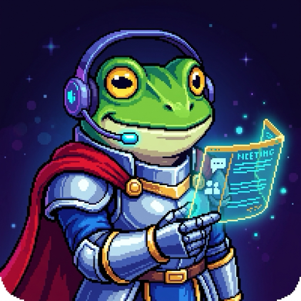

# 🐸 FroggIteAms — MS Teams Live Transcriber & AI Assistant (Tactiq Alternative)

  

**FroggIteAms** es una extensión para Google Chrome (Manifest V3) inspirada en **Tactiq**, diseñada para capturar y transcribir conversaciones en tiempo real desde **Microsoft Teams en el navegador**, gestionar el histórico de reuniones realizadas, exportar en formatos `.TXT` (idéntico al estándar de Tactiq) y `.CSV`, y generar automáticamente un **Reporte de Solicitudes y Compromisos** utilizando el proveedor de IA que prefieras (**Google Gemini vía OAuth 2.0 o API Key**, **DeepSeek**, **OpenAI**, **Groq**, o su motor heurístico local).

---

## ✨ Características Principales

1. **🎙️ Transcripción en Tiempo Real en Microsoft Teams (`teams.microsoft.com` / `teams.live.com`)**
   - Widget flotante arrastrable dentro de la llamada de MS Teams.
   - Captura automática de los subtítulos en vivo (*Live Captions*) del DOM de Microsoft Teams (compatible con Teams v2 y clásico) + modo híbrido por voz (*Web Speech API*).
   - Botón rápido para marcar intervenciones importantes como **⭐ Highlights**.

2. **🤖 Multi-Proveedor de IA (Bring Your Own Token / OAuth)**
   - **Google Gemini**: Soporta inicio de sesión y Bearer Token vía **OAuth 2.0** (`chrome.identity`) o **API Key** de Google AI Studio (`gemini-2.0-flash`).
   - **DeepSeek**: Soporte nativo para `deepseek-chat` / `deepseek-reasoner`.
   - **OpenAI / Groq / Custom**: Cualquier endpoint compatible con OpenAI Chat Completions.
   - **Motor Heurístico Local**: Si no configuras un token externo, analiza la reunión localmente sin conexión para que siempre puedas generar reportes.

3. **📊 Menú Histórico Estilo Tactiq (`Popup` + `Dashboard Completo`)**
   - Buscador instantáneo por título de reunión, participante o palabra hablada.
   - Incluye pre-cargada la reunión de ejemplo **`Coordinación Traspaso Cuenta Ms Azure`** y permite importar cualquier archivo `.txt` previo.

4. **📄 Exportación Exacta a `.TXT` y `.CSV`**
   - **Exportación `.TXT`**: Genera exactamente la estructura de encabezados (`# Título`, `Meeting started:`, `Duration:`, `Participants:`, `## Highlights` con citas `> MM:SS Hablante: Texto`, y `## Transcript` con `MM:SS Hablante: Texto`), tal como el archivo `Coordinación Traspaso Cuenta Ms Azure.txt`.
   - **Exportación `.CSV`**: Tabla compatible con Excel (UTF-8 con BOM) con columnas de reunión, fecha, minuto, hablante, mensaje, indicador de Highlight y detección de solicitud.

5. **📋 Reporte de Solicitudes Realizadas en la Reunión**
   - Extrae automáticamente todas las **solicitudes, compromisos, responsables asignados, quién lo solicitó, nivel de prioridad, minuto exacto, plazo y estado** (`Pendiente`, `Programado`, `En curso`, `Completado`), además de acuerdos clave y resumen ejecutivo.
   - Descargable de forma independiente en `.TXT` o `.CSV` o anexado al final de la transcripción.

---

## 🚀 Instalación en Google Chrome

1. Abre Google Chrome y navega a `chrome://extensions/`.
2. Activa el interruptor **Modo de desarrollador** (*Developer mode*) en la esquina superior derecha.
3. Haz clic en **Cargar descomprimida** (*Load unpacked*).
4. Selecciona la carpeta de este repositorio (`FroggIteAms`).
5. ¡Listo! Verás el icono de **Frog (Chrono Trigger) con headset de MS Teams** en tu barra de extensiones.
