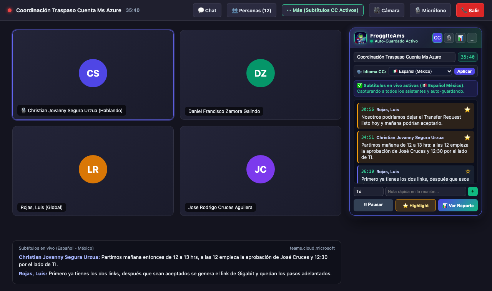
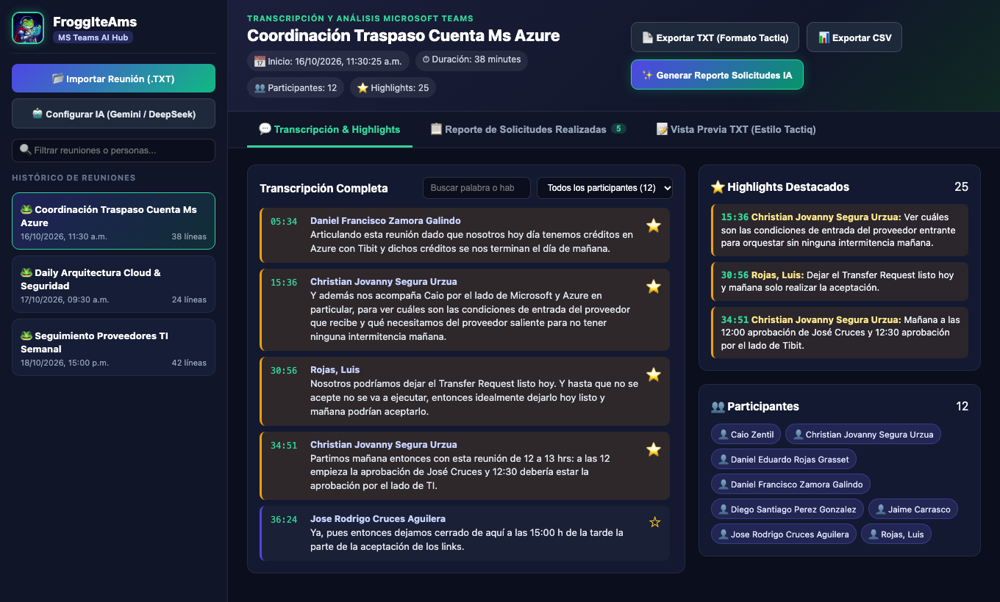

# 🐸 FroggIteAms — MS Teams Live Transcriber & AI Assistant

<p align="center">
  
</p>

<p align="center">
  <a href="https://github.com/DanimanX/FroggIteAms/actions/workflows/build-extension.yml">
    
  </a>
</p>

**FroggIteAms** is a Google Chrome Extension (Manifest V3) inspired by **Tactiq**, built to capture and transcribe conversations in real time from **Microsoft Teams on the web** (`teams.cloud.microsoft`, `teams.microsoft.com`, `teams.live.com`), manage your meeting history, export transcripts in `.TXT` (Tactiq-compatible format) and `.CSV`, and automatically generate **Meeting Action & Requests Reports** using your preferred AI provider (**Google Gemini via OAuth 2.0 or API Key**, **DeepSeek**, **OpenAI**, **Groq**, or the built-in offline heuristic engine).

---

<p align="center">
  FroggIteAms is free and open source. If it earns a place in your workflow and you
  feel like saying thanks, you can buy me a coffee — completely optional.
</p>

<p align="center">
  <a href="https://paypal.me/DanimanX?locale.x=en_US&amp;country.x=CL">
    
  </a>
</p>

<p align="center">
  <sub><a href="https://paypal.me/DanimanX?locale.x=en_US&amp;country.x=CL">paypal.me/DanimanX</a></sub>
</p>

---

## 📸 Screenshots & UI Preview

### 1. In-Call Floating Transcriber Window (`teams.cloud.microsoft`)
Automatically activates when you join a Microsoft Teams meeting, enables **Live Captions (CC)** in **Spanish (Mexico)** by default, captures all participants in real time, and continuously auto-saves every spoken line.

<p align="center">
  
</p>

### 2. Full Meeting History & AI Requests Hub (Tactiq-Style Dashboard)
Browse past meetings, filter by speaker or keyword, curate **⭐ Highlights**, export to `.TXT` / `.CSV`, and generate **AI Action & Requests Reports**.

<p align="center">
  
</p>

---

## ✨ Key Features

1. **🎙️ Real-Time Transcription in Microsoft Teams (`teams.cloud.microsoft`, `teams.microsoft.com`, `teams.live.com`)**
   - Floating, draggable in-call widget that only activates when you are inside an active Microsoft Teams meeting (strictly ignores regular group chats and channel messages).
   - Automatic activation and extraction of **MS Teams Live Captions (CC)** across all meeting participants, with **Spanish (Mexico) (`es-MX`)** set as the default spoken language and a built-in language selector (`es-MX`, `es-ES`, `es-CL`, `en-US`, `pt-BR`).
   - Continuous **real-time auto-save**: every spoken phrase is saved immediately into your meeting history so no data is ever lost when a meeting ends or the browser tab closes.
   - One-click **⭐ Highlight** tagging during live calls.

2. **🤖 Bring Your Own AI Token / OAuth (Multi-Provider)**
   - **Google Gemini**: Supports **Google OAuth 2.0** (`chrome.identity` flow or Bearer Token) and **Google AI Studio API Key** (`gemini-2.0-flash`).
   - **DeepSeek**: Native support for `deepseek-chat` / `deepseek-reasoner`.
   - **OpenAI / Groq / Custom**: Supports any OpenAI-compatible Chat Completions endpoint.
   - **Local Heuristic Analyzer**: Works out of the box without any external API token.

3. **📊 Tactiq-Style Meeting History Hub (`Popup` + `Full Dashboard`)**
   - Instant search by meeting title, participant, or spoken keyword.
   - Speaker filter chips and interactive **Highlights** manager.
   - Supports importing existing `.txt` transcripts.

4. **📄 Exact `.TXT` & `.CSV` Exports**
   - **`.TXT` Export**: Matches the exact Tactiq structure (`# Title`, `Meeting started:`, `Duration:`, `Participants:`, `## Highlights` with `> MM:SS Speaker: Text`, and `## Transcript` with `MM:SS Speaker: Text`).
   - **`.CSV` Export**: Excel-compatible UTF-8 BOM spreadsheet with meeting metadata, timestamps, speaker names, messages, highlight flags, and request indicators.

5. **📋 Automated Meeting Requests & Commitments Report**
   - Extracts all **action requests, commitments, requesters, assignees, priorities, timestamps, deadlines, and statuses** (`Pending`, `Scheduled`, `In Progress`, `Completed`), plus an Executive Summary and Key Agreements.
   - Exportable as standalone `.TXT` or `.CSV` files, or appended directly to the transcript export.

---

## 📦 Installation in Google Chrome

### Option A: From GitHub Releases / Actions Artifact (`.zip` / `.crx`)
1. Go to the [**Actions**](https://github.com/DanimanX/FroggIteAms/actions) or [**Releases**](https://github.com/DanimanX/FroggIteAms/releases) tab of this repository and download `froggiteams-chrome-extension.zip`.
2. Extract the `.zip` archive to a folder on your computer.
3. Open Google Chrome and navigate to `chrome://extensions/`.
4. Enable **Developer mode** in the top-right corner.
5. Click **Load unpacked** and select the extracted folder (or drag and drop the packaged extension).

### Option B: From Source
1. Clone this repository:
   ```bash
   git clone https://github.com/DanimanX/FroggIteAms.git
   ```
2. Open `chrome://extensions/` in Google Chrome.
3. Enable **Developer mode**.
4. Click **Load unpacked** and select the `FroggIteAms` directory.

---

## 🛠️ Automated Build (GitHub Actions)

Every push to `main` (and any version tag `v*`) triggers the [`.github/workflows/build-extension.yml`](.github/workflows/build-extension.yml) workflow, which:
- Validates the extension `manifest.json` and all ES module scripts (`background.js`, `content.js`, `popup.js`, `dashboard.js`).
- Packages the production-ready Chrome Extension bundle (`froggiteams-chrome-extension.zip` and `.crx`).
- Uploads the compiled Chrome plugin as a downloadable GitHub Actions artifact (and attaches it automatically to GitHub Releases).
